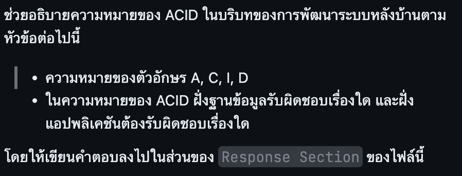

## Question

## Response Section

ACID คือคุณสมบัติ 4 ข้อของ **database transaction** ที่ทำให้ข้อมูลถูกต้องและเชื่อถือได้ แม้มีหลาย request ทำงานพร้อมกัน หรือระบบล่มกลางทาง ถ้าไม่มี ACID อาจเกิด data loss, inconsistent data หรือ race condition

### 1. ความหมายของ A, C, I, D

**ตัวอย่างที่ใช้ประกอบ:** ลูกค้าสั่งซื้อสินค้าบน e-commerce ระบบต้องทำ 3 อย่างใน transaction เดียว

```sql
BEGIN;
UPDATE products SET stock = stock - 1 WHERE id = 10;       -- ตัด stock
INSERT INTO orders (customer_id, product_id, status) VALUES (1, 10, 'paid');  -- สร้าง order
INSERT INTO payments (order_id, amount) VALUES (..., 500); -- บันทึกการชำระเงิน
COMMIT;
```

| ตัวอักษร | ความหมาย | ในตัวอย่าง |
|---|---|---|
| **A – Atomicity** | ทุกคำสั่งใน transaction ต้อง **สำเร็จทั้งหมด หรือไม่สำเร็จเลย** (all or nothing) ถ้าคำสั่งใดล้ม ทั้ง transaction จะ rollback | ถ้า insert payment ล้ม stock ที่ตัดไปแล้วต้องถูกคืน จะไม่มีกรณีตัด stock ไปแต่ไม่มี order |
| **C – Consistency** | transaction พาข้อมูลจากสถานะที่ถูกต้องไปสู่สถานะที่ถูกต้องเสมอ ต้องไม่ละเมิดกฎที่กำหนดไว้ เช่น constraint, foreign key, unique, check | ถ้ามี `CHECK (stock >= 0)` แล้ว stock จะติดลบ DB จะปฏิเสธและ rollback ทั้ง transaction |
| **I – Isolation** | transaction ที่ทำงานพร้อมกันจะไม่เห็นข้อมูลที่อีกฝั่งยังไม่ commit และไม่รบกวนกันจนผลผิด ความเข้มงวดขึ้นกับ **isolation level** (Read Uncommitted → Read Committed → Repeatable Read → Serializable) ซึ่งกันปัญหา dirty read, non-repeatable read และ phantom read ได้ต่างกัน | ลูกค้า 2 คนกดซื้อสินค้าชิ้นสุดท้ายพร้อมกัน ต้องมีคนได้แค่คนเดียว ไม่ใช่ทั้งคู่เห็น stock = 1 แล้วขายได้ทั้งคู่ (oversell) |
| **D – Durability** | เมื่อ commit สำเร็จแล้ว ข้อมูลต้อง **ไม่หาย** แม้ไฟดับหรือ server crash ทันทีหลังจากนั้น DB ทำได้โดยเขียน log ลง disk ก่อน (Write-Ahead Log / redo log) | ลูกค้าเห็นหน้า "สั่งซื้อสำเร็จ" แล้ว server ล่ม เมื่อกลับมา order ต้องยังอยู่ |

### 2. ฝั่งฐานข้อมูลรับผิดชอบอะไร และฝั่งแอปพลิเคชันรับผิดชอบอะไร

ACID ไม่ได้เกิดขึ้นเองทั้งหมด DB มี **กลไก** ให้ แต่แอปต้อง **ใช้กลไกนั้นให้ถูก** ถ้าแอปใช้ผิด ACID ของ DB ก็ช่วยไม่ได้

| | ฝั่ง Database รับผิดชอบ | ฝั่ง Application รับผิดชอบ |
|---|---|---|
| **A** | กลไก commit / rollback รับประกันว่า rollback ได้จริงเมื่อ error หรือ crash | **กำหนดขอบเขตของ transaction** ให้ถูก ว่าคำสั่งไหนต้องอยู่ใน `BEGIN ... COMMIT` เดียวกัน และจับ error แล้วสั่ง rollback ถ้าแอปแยกคำสั่งไปคนละ transaction ตัว DB ก็ไม่รู้ว่าคำสั่งเหล่านั้นต้องไปด้วยกัน |
| **C** | บังคับใช้ **constraint ที่ประกาศไว้** เช่น `NOT NULL`, `UNIQUE`, `FOREIGN KEY`, `CHECK` | **ประกาศ constraint ให้ครบ** ใน schema และดูแล **business rule** ที่ DB ไม่รู้จัก เช่น "ครูต้องสอนห้องที่อยู่ในโรงเรียนเดียวกัน" หรือ "ห้ามสั่งซื้อเกินวงเงิน" ต้อง validate ที่แอป |
| **I** | จัดการ lock และ MVCC ตาม isolation level ที่ถูกเลือก | **เลือก isolation level ให้เหมาะกับงาน** (default มักเป็น Read Committed ซึ่งกัน oversell ไม่ได้) หรือใช้ `SELECT ... FOR UPDATE` หรือ optimistic locking (version column) กับจุดที่มี race condition รวมถึงจัดการ deadlock และ serialization error ด้วยการ retry |
| **D** | เขียน WAL ลง disk ก่อนตอบว่า commit สำเร็จ รวมถึง replication และ backup | ตอบ client ว่าสำเร็จ **หลัง commit เท่านั้น** และตั้งค่า DB ไม่ให้ลด durability เพื่อแลกความเร็ว (เช่น `synchronous_commit = off`) ในข้อมูลสำคัญ |

**สิ่งที่อยู่นอก ACID ของ DB ทั้งหมด และแอปต้องรับผิดชอบเอง:** งานที่เกี่ยวกับระบบภายนอก เช่น ตัดเงินผ่าน payment gateway, ส่ง email หรือเรียก API ขนส่ง ไม่สามารถ rollback ไปพร้อมกับ DB transaction ได้ แอปต้องใช้เทคนิคเพิ่มเติม เช่น

- **Idempotency key** เพื่อให้ retry ได้โดยไม่ตัดเงินซ้ำ
- **Outbox pattern** บันทึก event ลง DB ใน transaction เดียวกับข้อมูล แล้วมี worker แยกไปส่งให้ระบบภายนอก
- **Saga / compensation** ถ้าขั้นตอนหลังล้ม ให้ทำรายการย้อนกลับ เช่น refund หรือคืน stock

ตัวอย่างเช่น ขั้นตอน "จัดส่งสินค้า" และ "ลูกค้าได้รับสินค้า" ใช้เวลาหลายวันและเกี่ยวกับระบบภายนอก จึงไม่ควรอยู่ใน DB transaction เดียวกับการสั่งซื้อ แต่ควรเป็นการเปลี่ยน status ของ order ทีละขั้น โดยแต่ละขั้นเป็น transaction ของตัวเอง

**ตัวอย่างจากส่วนที่ 4 ของข้อสอบนี้**
- `UniqueConstraint(school, grade, room)` และ `on_delete=PROTECT` เป็นกฎที่ประกาศให้ **DB บังคับใช้** (C)
- `validate_school` / `TeacherSerializer.validate` เป็น business rule ที่ **แอปต้องเช็คเอง** เพราะ DB ไม่รู้ความสัมพันธ์ "ห้องกับครูต้องอยู่โรงเรียนเดียวกัน"
