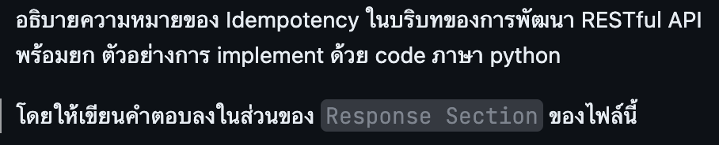

## Question



## Response Section

### Idempotency คืออะไร

**Idempotent** คือคุณสมบัติของ operation ที่ **เรียกซ้ำกี่ครั้งก็ได้ ผลต่อสถานะของ server เหมือนกับเรียกครั้งเดียว**

> f(f(x)) = f(x)

สิ่งที่ต้องเหมือนกันคือ **ผลกระทบต่อข้อมูลฝั่ง server** ไม่จำเป็นต้องเป็น response ตัวอย่างเช่น `DELETE /users/1` ครั้งแรกได้ `204` ครั้งที่สองได้ `404` ยังถือว่า idempotent เพราะทั้งสองครั้งจบที่สถานะเดียวกัน คือ "ไม่มี user 1"

ต้องแยกจากคำว่า **Safe** ซึ่งหมายถึง operation ที่ **ไม่เปลี่ยนสถานะของ server เลย** ทุก method ที่ safe เป็น idempotent ด้วย แต่ method ที่ idempotent ไม่จำเป็นต้อง safe เช่น PUT และ DELETE เปลี่ยนข้อมูลแต่ยัง idempotent

### HTTP methods ตาม RFC 9110

| Method | Safe | Idempotent | เหตุผล |
|---|:---:|:---:|---|
| GET, HEAD, OPTIONS | ✅ | ✅ | อ่านอย่างเดียว ไม่เปลี่ยนข้อมูล |
| PUT | ❌ | ✅ | **แทนที่ทั้ง resource** ด้วยค่าที่ส่งมา ส่ง `{"age": 35}` 10 ครั้งก็ได้ age = 35 เหมือนเดิม |
| DELETE | ❌ | ✅ | ลบไปแล้ว ลบซ้ำก็ยังไม่มีเหมือนเดิม |
| POST | ❌ | ❌ | สร้าง resource ใหม่ทุกครั้ง ส่ง 2 ครั้งได้ 2 order |
| PATCH | ❌ | ❌ (ขึ้นกับวิธีเขียน) | `{"age": 35}` idempotent แต่ `{"op": "increment", "age": 1}` ไม่ idempotent |

method ที่ระบุว่า idempotent เป็นแค่ **ข้อตกลงที่ server ต้องทำตาม** ถ้าเขียน `PUT` ให้ทำ `balance += 100` ก็จะไม่ idempotent ทั้งที่ใช้ PUT

### ทำไมต้องมี Idempotency

network ไม่ได้เชื่อถือได้ 100% กรณีที่พบบ่อยคือ:

1. client ส่ง `POST /payments` (ตัดเงิน 500 บาท)
2. server ตัดเงินสำเร็จ แต่ response หายระหว่างทาง (timeout, network หลุด, mobile เปลี่ยนสัญญาณ)
3. client ไม่รู้ว่าสำเร็จหรือไม่ จึง **retry** หรือผู้ใช้กดปุ่มซ้ำ
4. ถ้า API ไม่ idempotent ลูกค้าจะ **ถูกตัดเงิน 2 ครั้ง**

client, load balancer และ library หลายตัว **retry ให้อัตโนมัติ** โดยเฉพาะ method ที่ idempotent เพราะถือว่าปลอดภัย API ที่ทำตามข้อตกลงนี้จะทำให้การ retry ไม่สร้างข้อมูลผิด

### ทำให้ POST เป็น Idempotent ด้วย Idempotency-Key

วิธีที่ใช้กันทั่วไป (เช่น Stripe และ PayPal):

1. client สร้าง key ที่ไม่ซ้ำ (UUID) **หนึ่งครั้งต่อการทำรายการหนึ่งรายการ** แล้วส่งมาใน header `Idempotency-Key` ถ้า retry ต้องใช้ **key เดิม**
2. server บันทึก key พร้อม response ไว้ ถ้า key เดิมเข้ามาอีกจะ **ไม่ทำรายการซ้ำ** แต่คืน response เดิม
3. ถ้า key เดิมแต่ request body ต่างไป แสดงว่า client ใช้ผิด ให้ตอบ `422`
4. ใช้ **unique constraint** ใน DB กันกรณีที่ request ซ้ำเข้ามาพร้อมกันพอดี ถ้าเช็คด้วย `if exists` ในโค้ดอย่างเดียว 2 request จะผ่านการเช็คไปพร้อมกันได้ (race condition)

### ตัวอย่าง implement ด้วย Python (Django REST Framework)

`models.py`

```python
from django.conf import settings
from django.db import models


class Payment(models.Model):
    order_id = models.IntegerField()
    amount = models.DecimalField(max_digits=10, decimal_places=2)
    created_at = models.DateTimeField(auto_now_add=True)


class IdempotencyRecord(models.Model):
    user = models.ForeignKey(settings.AUTH_USER_MODEL, on_delete=models.CASCADE)
    key = models.CharField(max_length=255)
    request_hash = models.CharField(max_length=64)
    response_status = models.PositiveSmallIntegerField()
    response_body = models.JSONField()
    created_at = models.DateTimeField(auto_now_add=True)

    class Meta:
        constraints = [
            # unique index ทำให้ key เดียวกันถูกบันทึกได้ครั้งเดียว แม้ request มาพร้อมกัน
            models.UniqueConstraint(fields=['user', 'key'], name='unique_idempotency_key_per_user'),
        ]
```

`views.py`

```python
import hashlib
import json

from django.db import IntegrityError, transaction
from rest_framework import serializers, status
from rest_framework.response import Response
from rest_framework.views import APIView

from payments.models import IdempotencyRecord, Payment


class PaymentSerializer(serializers.ModelSerializer):
    class Meta:
        model = Payment
        fields = ['id', 'order_id', 'amount', 'created_at']


class PaymentCreateView(APIView):
    def post(self, request):
        key = request.headers.get('Idempotency-Key')
        if not key:
            return Response({'detail': 'Idempotency-Key header is required.'}, status=status.HTTP_400_BAD_REQUEST)

        serializer = PaymentSerializer(data=request.data)
        serializer.is_valid(raise_exception=True)
        request_hash = hashlib.sha256(json.dumps(request.data, sort_keys=True).encode()).hexdigest()

        try:
            # บันทึก payment และ key ใน transaction เดียวกัน:
            # สำเร็จพร้อมกัน หรือ rollback พร้อมกัน (ถ้าล้ม client retry ด้วย key เดิมได้)
            with transaction.atomic():
                payment = serializer.save()
                body = PaymentSerializer(payment).data
                IdempotencyRecord.objects.create(
                    user=request.user, key=key, request_hash=request_hash,
                    response_status=status.HTTP_201_CREATED, response_body=body,
                )
            return Response(body, status=status.HTTP_201_CREATED)
        except IntegrityError:
            # key นี้เคยถูกใช้แล้ว → payment ด้านบนถูก rollback ไป ไม่เกิดรายการซ้ำ
            record = IdempotencyRecord.objects.filter(user=request.user, key=key).first()
            if record is None:
                raise
            if record.request_hash != request_hash:
                return Response(
                    {'detail': 'Idempotency-Key was already used with a different request body.'},
                    status=status.HTTP_422_UNPROCESSABLE_ENTITY,
                )
            return Response(record.response_body, status=record.response_status, headers={'Idempotent-Replayed': 'true'})
```

`urls.py`

```python
path('payments/', PaymentCreateView.as_view()),
```

**ลำดับการทำงาน**

```
POST /payments/  Idempotency-Key: abc-123  {"order_id": 1, "amount": "500.00"}
→ 201 {"id": 1, ...}                          # ครั้งแรก: สร้าง payment + บันทึก key

POST /payments/  Idempotency-Key: abc-123  {"order_id": 1, "amount": "500.00"}   (retry)
→ 201 {"id": 1, ...}  Idempotent-Replayed: true   # ไม่สร้างใหม่ คืน response เดิม

POST /payments/  Idempotency-Key: abc-123  {"order_id": 1, "amount": "999.00"}
→ 422                                          # key เดิมแต่ body ต่าง

POST /payments/  (ไม่มี header)
→ 400
```

**จุดสำคัญในการออกแบบ**

- **บันทึก payment และ key ใน `transaction.atomic()` เดียวกัน** ถ้าขั้นตอนไหนล้ม ทั้งคู่ rollback พร้อมกัน client จึง retry ด้วย key เดิมได้ และจะไม่มีกรณีที่ key ถูกบันทึกแต่ payment ไม่ถูกสร้าง
- **กัน race condition ด้วย `UniqueConstraint`** ถ้า 2 request ที่ใช้ key เดียวกันเข้ามาพร้อมกัน DB ให้ insert สำเร็จได้แค่ตัวเดียว ตัวที่สองจะได้ `IntegrityError` แล้ว payment ของตัวนั้นถูก rollback จากนั้นจะไปอ่าน response ที่บันทึกไว้แทน
- **ผูก key กับ user** user คนอื่นที่บังเอิญใช้ key เดียวกันจะไม่เห็น response ของกันและกัน
- **เก็บ hash ของ request body** เพื่อจับกรณีที่ใช้ key ซ้ำกับคนละรายการ

**ข้อจำกัดและสิ่งที่ต้องทำเพิ่มในระบบจริง**

- **ถ้ามีการเรียกระบบภายนอก** (เช่น payment gateway) ระบบภายนอกจะไม่ rollback ตาม DB transaction ต้องบันทึก key ด้วยสถานะ `processing` ก่อน แล้วค่อยเรียกระบบภายนอก ถ้า request ซ้ำเข้ามาระหว่างนั้นให้ตอบ `409 Conflict` และควรส่ง idempotency key ต่อไปให้ระบบภายนอกด้วย
- **ตั้งเวลาหมดอายุของ key** (เช่น 24 ชั่วโมง) และลบ record เก่าเป็นระยะ ไม่ให้ตารางโตไม่จำกัด
- ถ้าใช้ Redis แทน DB ก็ทำได้ด้วย `SET key value NX EX 86400` แต่จะไม่ได้ความเป็น atomic ร่วมกับ DB transaction

**ผลการทดสอบโค้ดชุดนี้** (Django 5.0 + DRF 3.15, `manage.py test`)

```
test_retry_with_same_key_creates_one_payment_and_replays_response ... ok   # retry → payment 1 รายการ, response เดิม
test_different_keys_create_two_payments ... ok                            # คนละ key → 2 รายการ
test_same_key_different_body_rejected ... ok                              # key เดิม body ต่าง → 422
test_missing_key_rejected ... ok                                          # ไม่มี key → 400
test_same_key_is_scoped_per_user ... ok                                   # key เดียวกันคนละ user ไม่ชนกัน
Ran 5 tests — OK
```
